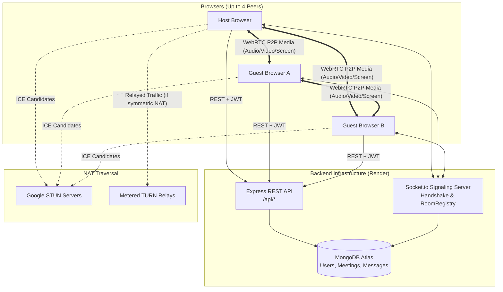
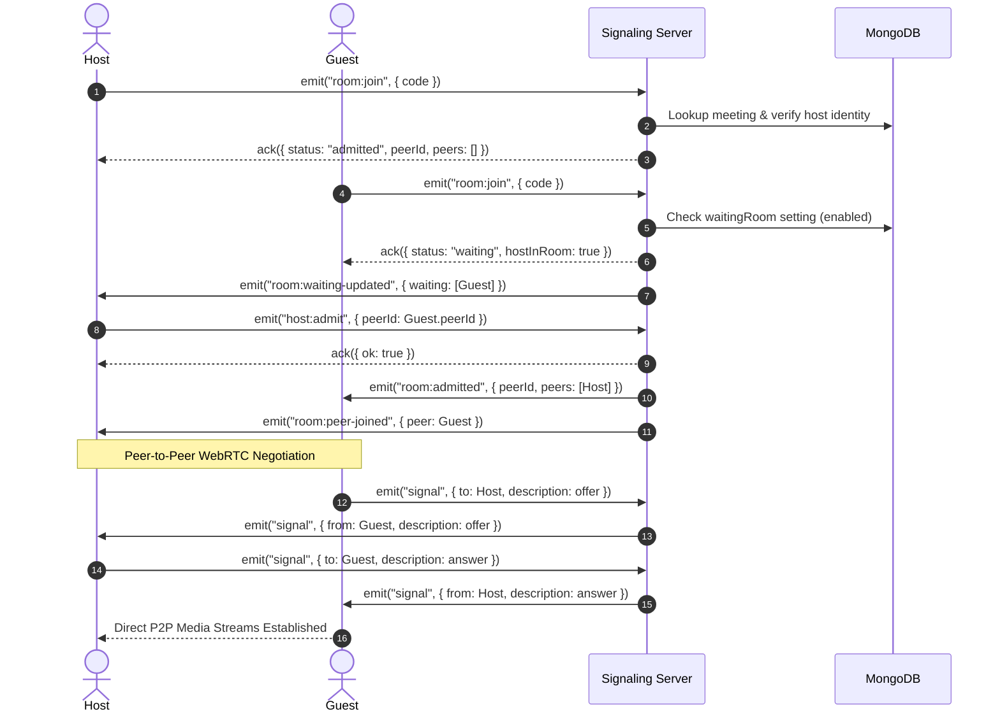

# JoinUs

Secure, host-moderated video meetings with custom WebRTC peer-to-peer signaling, real-time chat, and meeting history transcripts in your browser.

**Live Application:** [joinus-flame.vercel.app](https://joinus-flame.vercel.app)  
**API Health Check:** [joinus-vobk.onrender.com/api/health](https://joinus-vobk.onrender.com/api/health)

> [!NOTE]  
> The backend runs on a free Render web service that sleeps when idle. If the server has been inactive, the first request or socket handshake can take up to a minute to spin up. Built-in cold-start banners and loading states will keep you informed.

---

## Problem Statement

Small teams, study groups, clubs, and educators need simple, private, and controlled virtual meeting spaces without the overhead, aggressive paywalls, or privacy concerns of heavyweight commercial video platforms. 

Most link-based solutions either lack admission control (allowing anyone with the link to disrupt a session) or fail to preserve session context (leaving notes and chat lost when a tab closes). JoinUs provides lightweight, browser-based meeting rooms with host-controlled admission, in-call chat persistence, meeting history transcripts, and direct peer-to-peer media streams.

---

## Target Users

- **Hosts:** Team leads, study group organizers, club coordinators, and instructors who schedule sessions, monitor attendance, admit or remove guests, and moderate participants.
- **Participants:** Team members, students, and peers who join meetings via a shareable link from any desktop or mobile browser without installing native software or browser plugins.

---

## Solution

JoinUs decouples signaling and coordination from real-time media exchange:
1. **Control & Signaling Plane:** An API-first Node.js/Express backend paired with Socket.io manages authentication, room membership, admission queues, chat history persistence, and signaling.
2. **Media Plane:** Participants exchange audio, video, and screen tracks directly via a browser-native WebRTC full-mesh topology, backed by STUN/TURN servers for reliable NAT and firewall traversal.
3. **Client:** A modern, accessible React single-page application built on a cohesive Design Spec with dark/light themes, reactive error handling, offline detection, and mobile responsiveness.

---

## Key Features

- **Authentication & Sessions:** Secure sign up and login with bcrypt password hashing and JWT authentication tokens.
- **Instant & Scheduled Meetings:** Generate instant shareable meeting links with human-readable 10-character codes (e.g. `abc-defg-hij`) or schedule meetings with date and time pickers.
- **Host Waiting Room:** Meetings enable waiting rooms by default. Non-host guests are held in a waiting queue; hosts receive real-time notifications with inline admit/deny actions and bulk admit-all.
- **Host Moderation & Controls:** Dedicated sliding participants panel with real-time audio/video indicators, one-click participant removal (with confirmation modal), and host "End meeting for all".
- **Multi-Party WebRTC Video Grid:** Responsive P2P mesh grid supporting up to 4 participants (configurable up to 6) with smooth transitions, aspect-ratio preservation, and dedicated `ROOM_FULL` fallback states.
- **One-at-a-Time Screen Sharing:** Server-enforced single active sharer (`SCREEN_SHARE_BUSY`). Features stage-and-filmstrip layouts, presenter status banners, toasts, and host controls to stop presentations remotely.
- **Active Speaker Detection:** Real-time Web Audio API frequency and volume analysis highlighting the current speaker with glowing borders and animated audio meters.
- **In-Call Real-Time Chat & Persistence:** Admitted users exchange messages in real-time. Messages are validated (1–1000 characters), rate-limited (5 msgs / 5s), stored in MongoDB, and automatically reloaded upon reconnection.
- **Meeting History & Transcripts:** Past meetings automatically record duration, participant lists, and complete, timestamped read-only chat transcripts available on the History dashboard.
- **Resilience & Error Handling:** Global React Error Boundary, proper 404 page, browser offline banners, cold-start indicators for free-tier delays, and automated reconnection without duplicate tiles or messages.

---

## Tech Stack

| Layer | Technologies Used |
| :--- | :--- |
| **Frontend** | React 19, Vite, React Router 7, Lucide Icons, Modern Vanilla CSS Tokens |
| **Backend** | Node.js (v20+), Express 5, Socket.io 4, CommonJS |
| **Database & ODM** | MongoDB Atlas, Mongoose 9 |
| **Real-time Media** | WebRTC (P2P Mesh), STUN (Google), Metered.ca TURN API |
| **Auth & Security** | JWT (`jsonwebtoken`), `bcryptjs`, `zod`, `helmet`, `cors`, `express-rate-limit` |
| **Testing** | Node.js test runner (`node:test`), Jest, Supertest, `mongodb-memory-server` |
| **CI/CD & Hosting** | GitHub Actions, Vercel (Frontend), Render (Backend) |

---

## Architecture

### System Topology



### Join Flow with Waiting Room Sequence



### Data Model Summary

- **`User`**: Manages credentials (`email`, `passwordHash`), display name (`name`), and timestamps.
- **`Meeting`**: Stores meeting lifecycle details (`code`, `title`, `host`, `scheduledAt`, `startedAt`, `lastActiveAt`, `durationMs`, `status`: `'active'` | `'ended'` | `'cancelled'`, `waitingRoom`: boolean, and an `attendees` array of user IDs).
- **`Message`**: Stores persistent in-meeting chat (`meetingCode`, `sender`: `{ id, name }`, `text`: 1–1000 characters, optional `to` (User ID) and `toName` for private messages, `createdAt`).

### Authorization Matrix

| Endpoint / Event | Target | Required Role | Enforcement Mechanism |
| :--- | :--- | :--- | :--- |
| `POST /api/auth/register` | REST | Public | Rate limited (5/hr/IP), Zod schema |
| `POST /api/auth/login` | REST | Public | Rate limited (10/15m/IP+email), bcrypt comparison |
| `GET /api/auth/me` | REST | Authenticated User | Bearer JWT verification |
| `POST /api/meetings` | REST | Authenticated User | Bearer JWT verification, Zod schema |
| `GET /api/meetings` | REST | Authenticated User | Bearer JWT verification (returns user's meetings) |
| `GET /api/meetings/:code` | REST | Public | Minimal public metadata (title, host name, status) |
| `PATCH /api/meetings/:code` | REST | Meeting Host | Verified `userId === meeting.host` |
| `DELETE /api/meetings/:code`| REST | Meeting Host | Verified `userId === meeting.host` |
| `GET /api/history` | REST | Authenticated User | Returns meetings where user was host or attendee |
| `GET /api/history/:code` | REST | Host or Attendee | Verified user is in `meeting.attendees` or is host |
| `GET /api/meetings/:code/messages` | REST | Host or Attendee | Verified user is in `meeting.attendees` or is host; returns public messages plus private messages where user is sender or recipient |
| `GET /api/ice-servers` | REST | Authenticated User | Bearer JWT verification |
| `room:join` | Socket | Authenticated User | Socket JWT handshake, RoomRegistry capacity check |
| `host:admit` / `host:deny` | Socket | Meeting Host | Verified `registry.isHost(code, socket.user.id)` |
| `host:admit-all` | Socket | Meeting Host | Verified `registry.isHost(code, socket.user.id)` |
| `host:remove` | Socket | Meeting Host | Verified `registry.isHost(code, socket.user.id)` |
| `host:end` | Socket | Meeting Host | Verified `registry.isHost(code, socket.user.id)` |
| `host:stop-share` | Socket | Meeting Host | Verified `registry.isHost(code, socket.user.id)` |
| `chat:send` | Socket | Admitted Peer | Must be in active room, rate-limited (5/5s). Optional private recipient ('to') must be currently admitted; delivered only to sender and recipient |
| `share:start` | Socket | Admitted Peer | Single active presenter enforced by registry |
| `signal` | Socket | Admitted Peer | Relayed only between distinct peers in the same room |

---

## Local Setup

### Prerequisites
- **Node.js**: `v20.0.0` or higher
- **npm**: `v10.0.0` or higher
- **MongoDB**: Local MongoDB instance or free MongoDB Atlas URI

### Fresh Clone Commands

```bash
# 1. Clone the repository
git clone https://github.com/Ayushman-svg/JoinUs.git
cd JoinUs

# 2. Setup and run backend server
cd server
cp .env.example .env
npm install
npm run dev

# 3. Setup and run frontend client (in a new terminal)
cd ../client
cp .env.example .env
npm install
npm run dev
```

The client will start at `http://localhost:5173` and proxy/communicate with the backend server at `http://localhost:5000`.

---

## Environment Variables

### Server Configuration (`server/.env`)

| Variable | Required | Default | Description |
| :--- | :--- | :--- | :--- |
| `PORT` | No | `5000` | Port for Express & Socket.io server |
| `NODE_ENV` | No | `development` | Environment mode (`development`, `production`, `test`) |
| `MONGODB_URI` | **Yes** | — | MongoDB connection string (e.g. `mongodb+srv://...`) |
| `JWT_SECRET` | **Yes** | — | Cryptographic secret for JWTs (minimum 32 characters in production) |
| `JWT_EXPIRES_IN` | No | `7d` | Token validity period |
| `CLIENT_ORIGIN` | **Yes** | `http://localhost:5173` | Allowed CORS origins (comma-separated, no trailing slash) |
| `MAX_PARTICIPANTS` | No | `4` | Maximum participants in one room (range: 1 to 6) |
| `RATE_LIMIT_LOGIN_MAX` | No | `10` | Max login attempts per 15 minutes |
| `RATE_LIMIT_REGISTER_MAX` | No | `5` | Max registration attempts per hour |
| `RATE_LIMIT_API_MAX` | No | `300` | Max general API requests per 15 minutes |
| `TURN_URLS` | No | — | Optional static TURN server URLs |
| `TURN_USERNAME` | No | — | Optional static TURN username |
| `TURN_CREDENTIAL` | No | — | Optional static TURN password |
| `METERED_APP` | No | — | Optional Metered.ca app name for dynamic credentials |
| `METERED_API_KEY` | No | — | Optional Metered.ca API key (never exposed to clients) |

### Client Configuration (`client/.env`)

| Variable | Required | Default | Description |
| :--- | :--- | :--- | :--- |
| `VITE_API_URL` | **Yes** | `http://localhost:5000` | Backend API and Socket.io signaling base URL |

---

## Deployment

| Service | Host | Live URL |
| :--- | :--- | :--- |
| **Frontend SPA** | Vercel | [https://joinus-flame.vercel.app](https://joinus-flame.vercel.app) |
| **Backend API & Sockets** | Render | [https://joinus-vobk.onrender.com](https://joinus-vobk.onrender.com) |
| **Database** | MongoDB Atlas | Private Cluster |

### Redeployment & Configuration Notes
1. **Render (Backend):**
   - Web Service connected to the GitHub repository (Root directory: `server`).
   - Build Command: `npm install`
   - Start Command: `npm start`
   - Health check path set to `/api/health`.
   - Set environment variables as documented above. `app.set('trust proxy', 1)` is enabled to ensure rate limits track true client IPs behind Render's reverse proxy.
2. **Vercel (Frontend):**
   - Import project root directory `client` (Vite preset).
   - Set `VITE_API_URL` to `https://joinus-vobk.onrender.com`.
   - `client/vercel.json` contains SPA rewrite rules so direct visits to `/m/:code/call` or `/history` load properly without 404s.

---

## Security Summary

- **Password Storage:** Passwords hashed using `bcryptjs` with salt rounds = 10.
- **Token Security:** Signed JSON Web Tokens with strict secret enforcement (minimum 32 characters required in production).
- **HTTP Hardening:** Helmet middleware configured with secure headers; CORS configured to accept only exact matching origins (`CLIENT_ORIGIN`).
- **Input Validation:** Strict Zod schema validation applied to every REST endpoint body and Socket.io event payload before processing.
- **Dual-Layer Rate Limiting:**
  - REST: `express-rate-limit` protects `/api/auth/login` (10 per 15 min), `/api/auth/register` (5 per hour), and `/api/*` (300 per 15 min) with HTTP 429 and `Retry-After` headers.
  - Sockets: Sliding-window rate limiters protect `room:join` (10 per 10s), `signal` (300 per 10s), `host:*` actions (30 per 10s), and `chat:send` (5 per 5s).
- **Safe Logging & Error Handling:** Stack traces are never exposed in production. Metered API URLs and credentials are sanitized from log outputs to prevent secret leaks.

### Privacy Notes
- **Private Chat Messages:** In-meeting private messages between two participants are private to the sender and recipient. They are never broadcast to the room, never delivered to the host (unless the host is one of the two parties), and never viewable by any third party.
- **REST & History Authorization:** `GET /api/meetings/:code/messages` and History transcript views filter messages strictly on the server: attendees and hosts can only read public messages plus private messages where they are the sender or the recipient.

### Host Security & Permission Matrix (`FEATURE_HOST_SECURITY`)

Roles are derived strictly on the server:
- **Host (Creator):** The meeting owner. Holds root authority: end meeting for all, promote and demote co-hosts, lock/unlock room, adjust room settings, and moderate participants.
- **Co-host:** Promoted by the host. Can moderate participants (mute, ask to unmute, stop video, rename, remove, block, lock meeting, change room settings). **Co-hosts can never act on the host or promote/demote anyone.**
- **Participant:** Regular meeting attendee without moderation capabilities.

| Action | Host | Co-Host | Participant |
| :--- | :---: | :---: | :---: |
| End meeting for all | ✅ | ❌ | ❌ |
| Promote / Demote Co-Host | ✅ | ❌ | ❌ |
| Lock / Unlock Meeting | ✅ | ✅ | ❌ |
| Update Security Settings (`chatAllowed`, `shareAllowed`, `muteOnEntry`) | ✅ | ✅ | ❌ |
| Mute Participant | ✅ | ✅ *(participants only)* | ❌ |
| Mute All Participants | ✅ | ✅ *(excluding host)* | ❌ |
| Ask to Unmute *(dismissable prompt, never forced)* | ✅ | ✅ *(participants only)* | ❌ |
| Stop Video | ✅ | ✅ *(participants only)* | ❌ |
| Rename Participant *(for this room only)* | ✅ | ✅ *(participants only)* | ❌ |
| Remove / Block Participant | ✅ | ✅ *(participants only)* | ❌ |
| Send Chat *(when `chatAllowed = false`)* | ✅ | ✅ | ❌ |
| Share Screen *(when `shareAllowed = 'host-only'`)* | ✅ | ✅ | ❌ |

> **Browser Media Limitation Note:** Web browsers do not provide an operating system or hardware-level API that allows a remote web server to forcefully switch off or disable a client's physical microphone or camera hardware. Consequently, "Mute" and "Stop video" host controls operate as authoritative software directives sent to the client browser, which stops/disables the local media track. An unmute request is strictly a non-coercive prompt that the user may accept or dismiss.

---

## Testing

JoinUs maintains extensive automated test suites across both the server and the client with 100% database isolation.

### Running Backend Tests
```bash
cd server
npm test
```
*Covers 15 test suites and 123 tests using Jest, Supertest, and `mongodb-memory-server`:*
- `auth.test.js` & `security.test.js`: Registration, password length validation, JWT generation, error masking.
- `meetings.test.js` & `history.test.js`: Meeting creation, lifecycle states, participant authorization, chat history queries.
- `ice.test.js`: ICE / STUN endpoints and sanitized Metered TURN fallback.
- `rateLimitRest.test.js` & `rateLimitSocket.test.js`: REST 429 responses and socket sliding-window limits.
- `roomRegistry.test.js` & `waitingRoomSocket.test.js`: Room admission, capacity capping, host moderation, reconnection bypass.
- `chatSocket.test.js` & `chatPrivate.test.js`: Chat authorization, persistence, private messaging, and waiting room isolation.
- `screenShareSocket.test.js`: Single-presenter enforcement and room capacity boundaries.
- `features.test.js`: Feature flag resolution, fallback defaults, and `requireFeature` route middleware.
- `sanitizeLog.test.js`: Secret masking and log sanitation for uncaught exceptions and fatal errors.

### Running Frontend Tests
```bash
cd client
npm test
```
*Covers 26 unit tests using Node.js test runner (`node:test`):*
- `call.test.js`: Multi-party mesh offer generation, polite/impolite polarity derivation, peer cleanup, screen sharing lifecycle, active speaker audio tracking, network reconnection recovery without duplicate tiles, and room-full/ended meeting transitions.
- `helpers.test.js`: Duration formatting, local input string parsing, and meeting code extraction.
- `useFeature.test.js`: Feature flag fetching, cache storage, focus refetching, and fail-closed behavior on network failures.

---

## Release Safety

To ensure zero downtime and maintain safety when pushing changes to `main`, JoinUs follows a release safety architecture based on feature flags, fail-closed clients, isolated crash boundaries, strict local and CI verification, and rapid rollback workflows.

### 1. Feature Flags

All new features ship dark behind flags that default to `false` (OFF).

- **Server-Side Configuration:** `server/src/config/features.js` reads `FEATURE_<NAME>` environment variables. Unset variables evaluate to `false`.
- **Public Config Endpoint:** `GET /api/config` returns `{ features: { [name]: boolean } }` for consumption by the client without requiring authentication.
- **Route & Socket Protection:** Server routes can be protected using the `requireFeature(name)` middleware, which responds with HTTP 403 `{ error: 'FEATURE_DISABLED', message: '...' }`. Socket handlers check `assertFeature(name)` and ack with `{ ok: false, error: 'FEATURE_DISABLED' }`.
- **Fail-Closed Client:** The `useFeature(name)` React hook queries `/api/config` once, caches the result in memory, and refetches automatically on window focus. If the config request fails or the network drops, **every flag defaults to `false` (fail-closed)**. Disabled features render nothing (no links, buttons, or menu entries).
- **Crash Isolation:** Server process-level `uncaughtException` and `unhandledRejection` handlers log errors with the `[fatal]` prefix and strip out connection strings, JWTs, and passwords. Panels and complex components are wrapped in `<FeatureBoundary>` to present an inline "This feature is unavailable" fallback card with a Retry button rather than crashing the entire app into a blank screen.

#### Supported Flags

Flags are off by default and none of these features is live yet.

| Flag | Default | Planned feature |
| :--- | :--- | :--- |
| `FEATURE_LANDING` | `false` | Redesigned public landing page |
| `FEATURE_NEW_HOME` | `false` | New home dashboard layout |
| `FEATURE_ROOM_VIEWS` | `false` | Advanced video grid view modes (e.g. gallery/speaker) |
| `FEATURE_REACTIONS` | `false` | In-call floating emoji reactions and hand raising |
| `FEATURE_HOST_SECURITY` | `false` | Host security panel (lock room, mute all, disable share) |
| `FEATURE_POLLS` | `false` | In-meeting interactive polling |
| `FEATURE_CAPTIONS` | `false` | Live speech-to-text automated captions |
| `FEATURE_CHAT_PLUS` | `false` | Private messages, replies, search, emoji picker (no file attachments) |
| `FEATURE_SCHEDULING` | `false` | Advanced meeting recurrence and invite scheduling |
| `FEATURE_SETTINGS` | `false` | User preferences and device management |
| `FEATURE_RECORDING` | `false` | Local recording on the host's device only (no cloud) |
| `FEATURE_CALENDAR` | `false` | Built-in calendar agenda view |
| `FEATURE_SEARCH` | `false` | Global meeting and chat transcript search |
| `FEATURE_WHITEBOARD` | `false` | Interactive collaborative whiteboard |
| `FEATURE_CONTACTS` | `false` | Team contacts and address book |
| `FEATURE_TEAM_CHAT` | `false` | Out-of-meeting team messaging |
| `FEATURE_ACCOUNT_RECOVERY`| `false` | Self-service password reset and account recovery |
| `FEATURE_TWO_FACTOR` | `false` | Authenticator-app TOTP only (no SMS) |
| `FEATURE_SOCIAL_LOGIN` | `false` | Third-party OAuth authentication |
| `FEATURE_TRANSLATION` | `false` | Captions translated on the viewer's device (not chat) |
| `FEATURE_AI_RECAP` | `false` | Host-triggered recap of public chat and captions |
| `FEATURE_AI_COMPANION` | `false` | Ask questions about one past meeting from History (not real-time) |
| `FEATURE_CALENDAR_SYNC` | `false` | Google and Microsoft one-way event creation plus read-only busy times (not two-way) |

### 2. How to Turn a Feature On or Off

1. Open `server/.env` (locally) or navigate to the environment variable settings on your hosting provider (e.g., Render Dashboard):
   ```env
   # Turn a feature ON
   FEATURE_REACTIONS=true
   FEATURE_POLLS=true

   # Turn a feature OFF (or delete the line)
   FEATURE_REACTIONS=false
   ```
2. Restart or redeploy the server.
3. The REST API and Socket.io signaling server immediately apply the new flag states. Clients pick up the new configuration on initial page load or when switching back to the browser window.

### 3. Verification Script (`scripts/verify`)

Before opening a pull request or pushing to `main`, run the verification script. It executes backend tests, frontend tests, and the client build in sequence and exits non-zero if any step fails:

- **PowerShell (Windows):**
  ```powershell
  powershell -ExecutionPolicy Bypass -File scripts/verify.ps1
  ```
- **Bash (Linux / macOS / Git Bash):**
  ```bash
  ./scripts/verify
  # or
  bash scripts/verify.sh
  ```

The same script runs automatically on every push and pull request via `.github/workflows/ci.yml`.

### 4. Rollback Procedures

If an unexpected regression or service disruption occurs:

#### Option A: Instant Flag Killswitch (Zero Deployment)
If the regression is isolated to a flagged feature:
1. Set `FEATURE_<NAME>=false` in the server environment settings.
2. Restart the web service.
3. The server immediately blocks requests with `FEATURE_DISABLED` and clients hide the feature UI on their next window focus.

#### Option B: Code Rollback via `git revert` and Git Tag
If a code rollback is required:
1. Revert the offending commit locally:
   ```bash
   git revert <commit-sha> -m 1   # (use -m 1 only if reverting a merge commit)
   ```
2. Verify that all suites still pass:
   ```bash
   ./scripts/verify
   ```
3. Tag the rollback release for clear audit history:
   ```bash
   git tag -a v1.0.1-rollback -m "Rollback commit <commit-sha> due to incident"
   ```
4. Push to `main` and publish the tag:
   ```bash
   git push origin main --tags
   ```
5. Confirm that the automated CI pipeline succeeds and production platforms (Render/Vercel) deploy the rollback.

---

## Limitations & Trade-offs

- **Full Mesh Topology:** Every peer maintains an RTCPeerConnection with every other peer ($N \times (N - 1)$ connections). Mesh eliminates media server infrastructure costs and latency, but client bandwidth and CPU usage scale quadratically. It is intended for 3–4 participants and capped at a maximum of 6.
- **Authentication in localStorage:** Tokens are held in `localStorage` for simple client-side access without refresh-token rotation or email verification workflows.
- **Free-Tier Cold Starts:** On free hosting plans (Render), instances go to sleep after periods of inactivity, causing initial requests to experience a 30–60 second wake-up delay.
- **Web-First:** Designed for desktop and mobile web browsers; native mobile wrappers (e.g. React Native or Flutter) are planned for future phases.

---

## Future Work

- **Selective Forwarding Unit (SFU):** Transition to an SFU architecture (e.g. Mediasoup or LiveKit) to support larger team meetings (10–50+ participants) while reducing client CPU and bandwidth overhead.
- **End-to-End Chat Encryption:** Client-side encryption for in-meeting chat messages using Web Crypto API before persisting.
- **Virtual Backgrounds & Noise Suppression:** Canvas-based ML background blur/replacement and Web Audio API noise gate filters.
- **Breakout Rooms:** Allow hosts to split active room participants into temporary sub-rooms with timer controls.

---

## Credits

- **Web Frameworks & Realtime:** [Express](https://expressjs.com/), [Socket.io](https://socket.io/), [React](https://react.dev/), [Vite](https://vitejs.dev/)
- **Icons & Typography:** [Lucide React](https://lucide.dev/), [Inter Variable Font](https://rsms.me/inter/)
- **Validation & Security:** [Zod](https://zod.dev/), [Helmet](https://helmetjs.github.io/), [bcryptjs](https://github.com/dcodeIO/bcrypt.js)
- **TURN Relay Services:** [Metered.ca](https://www.metered.ca/)
- **AI Pairing:** Built with the assistance of Google DeepMind's Antigravity AI coding agent for architectural pair programming, automated test authoring, and resilience hardening.
