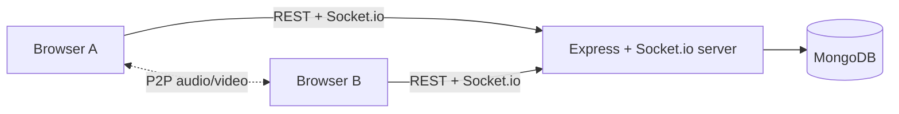

# JoinUs

A Zoom-style video meeting web app with custom WebRTC signaling. Create a meeting, share a link, admit guests from a waiting room and talk face to face in your browser.

Built without third-party media SDKs: peer connections use raw WebRTC and signaling runs on a hand-written Socket.io protocol.

**Live app:** [joinus-flame.vercel.app](https://joinus-flame.vercel.app) · **API health:** [joinus-vobk.onrender.com/api/health](https://joinus-vobk.onrender.com/api/health)

> The API runs on a free Render instance that sleeps when idle, so the first request after a pause can take up to a minute.

## Project Name

JoinUs: secure, browser-based video meetings with host-controlled admission.

## Problem Statement

Small teams, classes and study groups need a simple way to meet online without heavyweight platforms. JoinUs provides link-based meetings with host-controlled admission and reliable audio/video, even behind strict NATs.

## Target Users

- **Hosts:** teachers, team leads and organizers who schedule meetings and control who joins.
- **Participants:** anyone joining from a link on a desktop or mobile browser.

## Solution

A Node/Express + Socket.io server owns the business rules and relays signaling messages. A thin React client renders the state. Audio and video flow peer-to-peer (mesh, up to 6 participants) with STUN/TURN for NAT traversal.

The server is API-first and client-agnostic: authentication uses `Authorization: Bearer` tokens and the signaling layer is a plain JSON event protocol, so a mobile app can reuse the same backend.

## Key Features

Available now:

- Register and log in with JWT authentication
- Instant and scheduled meetings with shareable codes (e.g. `abc-defg-hij`)
- Waiting room setting on meeting creation (default enabled, enforced entirely on the server)
- Host-controlled waiting room with real-time updates, inline admit/deny, and bulk admit-all
- Host controls: sliding right-side Participants panel, remove participant with confirmation modal, and end meeting for all
- Centered status cards for waiting (with host-not-started variant), denied, removed, and ended states
- Bottom-left host waiting toasts with 8-second auto-dismiss and persistent waiting badge on control bar
- Modern design system with dark and light modes, Inter variable typography, and accessible primitives
- Authenticated app shell with collapsible sidebar, real-time client-side meeting search, and profile dropdown
- Dashboard with quick actions (New meeting, Join, Schedule), upcoming meeting cards, stats, and recent meetings
- Pre-join preview screen with camera preview, mic and camera toggles, and device permission guidance
- Multi-party mesh audio and video up to 6 participants
- In-meeting real-time and persisted chat: server-enforced access (admitted peers only), optimistic sending with retry states, 1000-character validation, rate-limited to 5 msgs / 5s, auto-growing input, unread count badge, stick-to-bottom with "New messages" pill, and mobile bottom sheet
- Meeting activity & history tracking: automatic `startedAt`, `lastActiveAt`, and `durationMs` tracking, attendee set persistence, and authenticated `/api/history` endpoints
- Meeting History page & transcripts: sidebar History navigation, searchable past meeting cards with duration and attendee counts, detailed view with attendee avatar row, read-only chat transcript, copy transcript button, and friendly 403 access control screen

Planned:

- Screen share, automatic reconnects, device switching and connection-quality indicator

## Tech Stack

| Layer | Technology |
| --- | --- |
| Client | React 19, Vite, React Router |
| Server | Node.js, Express, Socket.io |
| Database | MongoDB, Mongoose |
| Realtime media | WebRTC (P2P mesh), STUN + TURN |
| Auth and validation | JWT, bcryptjs, zod |
| Security | helmet, CORS allow-list |
| Testing | Jest, Supertest, mongodb-memory-server |
| Hosting | Vercel (client), Render (server), MongoDB Atlas (database) |

## Architecture



```
joinus/
├── client/              # React + Vite web client
│   └── src/
│       ├── api/         # fetch client that attaches the bearer token
│       ├── components/  # shared UI pieces
│       ├── context/     # AuthContext (session restore, login, logout)
│       ├── lib/         # pure helpers (dates, invite links)
│       └── pages/       # route-level screens
├── server/              # Express + Socket.io backend
│   ├── src/
│   │   ├── config/      # env validation, database connection
│   │   ├── controllers/ # request handlers
│   │   ├── middleware/  # auth, validation, error handling
│   │   ├── models/      # Mongoose models
│   │   ├── routes/      # route definitions
│   │   ├── schemas/     # zod request schemas
│   │   ├── sockets/     # Socket.io wiring, event handlers, room registry
│   │   └── utils/       # tokens, meeting codes, errors
│   └── tests/           # Jest + Supertest suites
└── README.md
```

### Signaling protocol

Realtime signaling runs on Socket.io, on the same origin as the REST API. The protocol is plain JSON events, so any client (web or mobile) can implement it.

**Connecting.** Pass the same JWT used for REST in the handshake: `io(API_URL, { auth: { token } })`. A refused connection fires `connect_error` with `err.data = { code, message }`, where `code` is `UNAUTHORIZED`, `INVALID_TOKEN` or `TOKEN_EXPIRED`.

**Identity.** The peer id is the `socket.id`. The user id and display name always come from the verified token, never from an event payload.

**Acknowledgements.** Every client-to-server event takes an ack callback that receives `{ ok: true, ...data }` or `{ ok: false, error: { code, message } }`.

Client to server:

| Event | Payload | Ack data | Error codes |
| --- | --- | --- | --- |
| `room:join` | `{ code, audio?, video? }` | `{ status: 'admitted', peerId, peers: [...], screenSharer? }` OR `{ status: 'waiting' }` | `VALIDATION_ERROR`, `MEETING_NOT_FOUND`, `MEETING_CANCELLED`, `MEETING_ENDED`, `ROOM_FULL`, `WAITING_FULL`, `ALREADY_IN_ROOM` |
| `host:admit` | `{ peerId }` | `{}` | `VALIDATION_ERROR`, `NOT_IN_ROOM`, `FORBIDDEN`, `PEER_NOT_FOUND`, `ROOM_FULL` |
| `host:deny` | `{ peerId }` | `{}` | `VALIDATION_ERROR`, `NOT_IN_ROOM`, `FORBIDDEN`, `PEER_NOT_FOUND` |
| `host:admit-all` | `{}` | `{}` | `NOT_IN_ROOM`, `FORBIDDEN` |
| `host:remove` | `{ peerId }` | `{}` | `VALIDATION_ERROR`, `NOT_IN_ROOM`, `FORBIDDEN`, `PEER_NOT_FOUND`, `CANNOT_REMOVE_SELF` |
| `host:end` | `{}` | `{}` | `NOT_IN_ROOM`, `FORBIDDEN` |
| `media:update` | `{ audio, video }` | `{}` | `VALIDATION_ERROR`, `NOT_IN_ROOM` |
| `share:start` | `{ streamId }` | `{}` | `VALIDATION_ERROR`, `NOT_IN_ROOM`, `SCREEN_SHARE_BUSY` |
| `share:stop` | `{}` | `{}` | `NOT_IN_ROOM`, `FORBIDDEN` |
| `host:stop-share` | `{}` | `{}` | `NOT_IN_ROOM`, `FORBIDDEN` |
| `chat:send` | `{ text }` | `{ message: { id, from, text, createdAt } }` | `VALIDATION_ERROR`, `NOT_IN_ROOM`, `RATE_LIMITED`, `CHAT_FAILED` |
| `room:leave` | none | `{}` | none (safe to call twice) |
| `signal` | `{ to, description?, candidate? }` | `{}` | `VALIDATION_ERROR`, `NOT_IN_ROOM`, `PEER_NOT_FOUND` |

Server to client:

| Event | Payload | Meaning |
| --- | --- | --- |
| `room:peer-joined` | `{ peerId, user: { id, name }, audio, video }` | Someone joined your room |
| `room:peer-updated` | `{ peerId, audio, video }` | Someone switched their microphone or camera on or off |
| `room:peer-left` | `{ peerId }` | Someone left, disconnected or was replaced by a newer session |
| `room:screen-updated` | `{ peerId, streamId }` | Screen share started or stopped (`null` if stopped) |
| `room:waiting-updated` | `{ waiting: [{ peerId, user: { id, name } }] }` | Waiting list changed (sent to host only) |
| `room:admitted` | `{ peerId, peers, screenSharer? }` | The host admitted you into the room |
| `room:denied` | `{}` | The host declined your admission |
| `room:removed` | `{ reason: 'REMOVED_BY_HOST' }` | You were removed from the meeting by the host |
| `room:ended` | `{}` | The host ended the meeting for everyone |
| `room:kicked` | `{ reason }` | You were removed from the room. `reason` is `JOINED_ELSEWHERE` |
| `chat:message` | `{ id, from: { id, name }, text, createdAt }` | A new chat message was sent in the room |
| `signal` | `{ from, description?, candidate? }` | A relayed WebRTC message from a peer in your room |

**Rules**

- A meeting is joinable only if it exists and is active. Unknown codes return `MEETING_NOT_FOUND`, cancelled meetings return `MEETING_CANCELLED`, and ended meetings return `MEETING_ENDED`.
- The meeting host (`Meeting.host`) always joins directly and bypasses the waiting room.
- If `meeting.waitingRoom` is true (default), non-host guests are placed into a waiting list until the host admits them.
- Waiting sockets do NOT join the broadcast room, receive no peer events, cannot send or receive chat, and cannot send or relay WebRTC signals.
- A user admitted by the host stays admitted for the life of that room, so a page refresh or reconnect does not send them back to waiting.
- Same user joining again (refresh or second tab): the newer session wins. If in waiting, the older waiting socket receives `room:kicked`; if in the room, peers see `room:peer-left` then `room:peer-joined`.
- Waiting list is capped at 20 per room (`WAITING_FULL`). Active room capacity is capped at `MAX_PARTICIPANTS` (1 to 6, default 4, `ROOM_FULL`).
- Screen share: exactly one active sharer per room, enforced on the server (`SCREEN_SHARE_BUSY`). The share ends if the sharer stops, leaves, disconnects, is removed by the host, or the meeting ends. The host can stop anyone's share (`host:stop-share`). Late joiners receive the current sharer on entry.
- Only the verified host can invoke `host:*` controls; unauthorized clients receive `FORBIDDEN`.
- When the host ends a meeting (`host:end`), `Meeting.status` is set to `ended`, `room:ended` is sent to all peers and waiting guests, and the room is cleared.
- `chat:send` accepts 1 to 1000 characters (trimmed), rate-limited to 5 messages per 5 seconds per socket (`RATE_LIMITED`). Messages are persisted in MongoDB and broadcast to all room peers (`chat:message`).
- `signal` carries exactly one of `description` or `candidate`, relayed only between two different peers in the same active room.
- Disconnecting removes the peer from its room or waiting list and notifies peers / the host.
- Messages are limited to 100 KB.

## API Reference

All errors share one shape: `{ "error": { "code": "...", "message": "...", "details": [...] } }`.

| Method | Endpoint | Auth | Description |
| --- | --- | --- | --- |
| GET | `/api/health` | none | Service health |
| POST | `/api/auth/register` | none | Create an account, returns `user` and `token` |
| POST | `/api/auth/login` | none | Log in, returns `user` and `token` |
| GET | `/api/auth/me` | Bearer | Current user |
| POST | `/api/meetings` | Bearer | Create an instant or scheduled meeting |
| GET | `/api/meetings?filter=upcoming\|past\|all` | Bearer | List your meetings |
| GET | `/api/meetings/:code` | none | Minimal public info for an invite page |
| PATCH | `/api/meetings/:code` | Host | Edit title or scheduled time |
| DELETE | `/api/meetings/:code` | Host | Cancel the meeting |
| GET | `/api/history` | Bearer | List past started meetings (host or admitted attendee) |
| GET | `/api/history/:code` | Bearer | Meeting history details and attendees list (host or attendee) |
| GET | `/api/meetings/:code/messages?limit=` | Bearer | Paginated chat messages (host or attendee) |
| GET | `/api/ice-servers` | Bearer | ICE (STUN and optional TURN) server configuration |

## Local Setup

Requires Node.js 20+ and MongoDB (local or Atlas).

```bash
git clone <your-repo-url> joinus
cd joinus

# Server
cd server
cp .env.example .env     # then fill in the values
npm install
npm run dev              # http://localhost:5000

# Client (new terminal)
cd client
cp .env.example .env
npm install
npm run dev              # http://localhost:5173
```

Generate a strong `JWT_SECRET` with:

```bash
node -e "console.log(require('crypto').randomBytes(48).toString('hex'))"
```

## Testing

```bash
cd server
npm test
```

The test suites run against an in-memory MongoDB (`mongodb-memory-server`) with zero external dependencies and 100% test isolation:

- `tests/auth.test.js`: registration, login, token verification, session protection
- `tests/meetings.test.js`: meeting creation, scheduling, edit/cancel authorization, `startedAt` / `lastActiveAt` activity tracking, `Message` model
- `tests/history.test.js`: `/api/history`, `/api/history/:code`, `/api/meetings/:code/messages` authorization (host and attendees allowed, outsiders 403)
- `tests/ice.test.js`: ICE / STUN / TURN credentials endpoint
- `tests/socketAuth.test.js`: Socket.io handshake authentication and rejection
- `tests/roomRegistry.test.js`: pure room registry, peer tracking, media updates, waiting room and host controls
- `tests/rateLimit.test.js`: pure sliding-window rate limiter (5 messages per 5s)
- `tests/waitingRoomSocket.test.js`: waiting list notification, host admit/deny, host end meeting
- `tests/chatSocket.test.js`: in-meeting real-time chat, persistence, 403 on waiting guest, 1000 char validation, rate limiting, and room isolation

## Environment Variables

**`server/.env`**

| Variable | Description |
| --- | --- |
| `NODE_ENV` | `development`, `test` or `production` |
| `PORT` | API port (set automatically on Render) |
| `MONGODB_URI` | MongoDB connection string |
| `JWT_SECRET` | Secret for signing JWTs, at least 32 characters |
| `JWT_EXPIRES_IN` | Token lifetime, e.g. `7d` |
| `CLIENT_ORIGIN` | Allowed CORS origin(s), comma-separated, no paths |
| `TURN_URLS` | Optional comma-separated TURN server URLs (e.g. `turn:turn.example.com:3478?transport=udp`) |
| `TURN_USERNAME` | Optional TURN username |
| `TURN_CREDENTIAL` | Optional TURN password / credential |
| `MAX_PARTICIPANTS` | Maximum room capacity (1 to 6, default 4) |

**`client/.env`**

| Variable | Description |
| --- | --- |
| `VITE_API_URL` | Base URL of the API server. Used for REST requests and for the Socket.io signaling connection (same server, same address) |

### Debugging and Forced TURN Relay

To test and verify that TURN relaying works as expected across strict networks, append `?relay=1` to any call URL (e.g. `/m/abc-defg-hij/call?relay=1`). This sets `iceTransportPolicy: 'relay'`, forcing WebRTC to ignore direct peer candidates and communicate strictly via the configured TURN relay.

The server validates its environment at startup and exits with a clear message if anything is missing or malformed.

## Deployment

| Component | Platform | URL |
| --- | --- | --- |
| Client | Vercel | https://joinus-flame.vercel.app |
| Server | Render | https://joinus-vobk.onrender.com |
| Database | MongoDB Atlas | private |

1. **MongoDB Atlas:** create an M0 cluster and a database user. Under Network Access allow `0.0.0.0/0` (Render's outbound IPs change). Copy the `mongodb+srv://` connection string and add `/joinus` as the database name.
2. **Render (server):** create a Web Service from this repository with root directory `server`, build command `npm install` and start command `npm start`. Set the health check path to `/api/health`. Add `NODE_ENV=production`, `MONGODB_URI`, `JWT_SECRET` (a new random value), `JWT_EXPIRES_IN` and `CLIENT_ORIGIN`.
3. **Vercel (client):** import the repository with root directory `client` (Vite preset). Set `VITE_API_URL` to the Render URL. `client/vercel.json` rewrites all routes to `index.html` so invite links like `/m/abc-defg-hij` work on refresh.
4. Set `CLIENT_ORIGIN` on Render to the Vercel URL so CORS allows the client.

Both platforms provide HTTPS, which browsers require for camera and microphone access.
